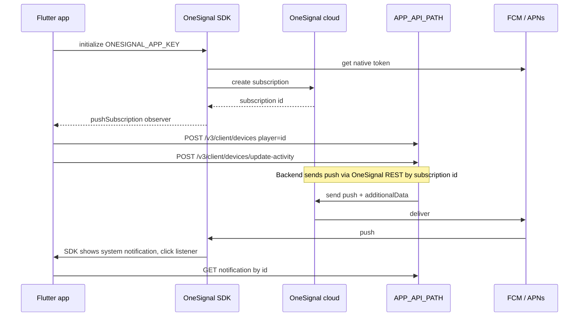
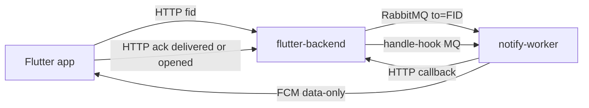

# Push-уведомления: анализ OneSignal → Firebase (FCM)

## 1. Как сейчас работает OneSignal

### 1.1 Что такое `ONESIGNAL_APP_KEY`

`ONESIGNAL_APP_KEY` из [`env/.env.production`](../env/.env.production:5) (и из `.env.development` / `.env.stage`) — это **OneSignal App ID**. Это не секрет, а публичный идентификатор «приложения» в кабинете OneSignal. На каждое окружение заведено своё OneSignal-приложение, поэтому ключей три.

Ключ используется в единственном месте — в [`OneSignal.initialize()`](../lib/main.dart:221). После этого SDK OneSignal делает всё сам:

1. Получает у ОС нативный push-токен: на Android это FCM-токен (OneSignal работает поверх Firebase, отсюда meta `com.google.firebase.messaging.default_notification_icon` в [`AndroidManifest.xml`](../android/app/src/main/AndroidManifest.xml:19)), на iOS — APNs-токен.
2. Регистрирует устройство на своём сервере и создаёт **Subscription** с id `OneSignal.User.pushSubscription.id` (раньше назывался `player_id`).
3. Хранит пару «Subscription id ↔ FCM/APNs-токен» у себя. Наш бэкенд нативные токены не видит, он знает только Subscription id.

### 1.2 Жизненный цикл устройства

| Момент | Где | Что происходит |
|---|---|---|
| Старт приложения | [`initPlatformState()`](../lib/main.dart:215) | init, слушатели, `requestPermission(true)` сразу при старте |
| Сменился Subscription id | [`pushSubscription.addObserver`](../lib/main.dart:246) | id сохраняется в prefs `onesignalId`; если пользователь авторизован и id изменился — [`SaveDevice`](../lib/redux/auth/auth_actions.dart:131) |
| Login / регистрация / восстановление пароля | [`AuthMiddleware`](../lib/redux/auth/auth_middleware.dart:31) | [`getOnesignalId()`](../lib/utils/common.dart:678) → `SaveDevice` |
| `SaveDevice` | [`auth_middleware.dart`](../lib/redux/auth/auth_middleware.dart:81) | `POST /v3/client/devices {player}`, затем `POST /v3/client/devices/update-activity {onesignal_id, app}` |
| Смена lifecycle (resumed/paused…) | [`home_page.dart`](../lib/screens/home/home_page.dart:101) | `UpdateDeviceActivity {onesignal_id, app, status}` |
| Logout / удаление аккаунта | [`drawer_layout.dart`](../lib/ui/drawer_layout.dart:28), [`home_page.dart`](../lib/screens/home/home_page.dart:133), [`private_info_screen.dart`](../lib/screens/aboutme/private_info/private_info_screen.dart:284) | `DELETE /v3/client/devices/{onesignalId}` |

### 1.3 Получение и отображение

- **Фон и закрытое приложение.** Уведомление рисует сам OneSignal SDK (системная нотификация). На iOS есть [`OneSignalNotificationServiceExtension`](../ios/OneSignalNotificationServiceExtension/NotificationService.swift) — он нужен для картинок, бейджа и подтверждения доставки.
- **Foreground.** [`addForegroundWillDisplayListener`](../lib/main.dart:229) вызывает `preventDefault()`, затем `GetCountInformation` (обновляет счётчики), затем `display()`.
- **Тап.** [`addClickListener`](../lib/main.dart:239) вызывает [`pushRouteOnPush(additionalData)`](../lib/main.dart:285). Роутинг строится по `additionalData`:
  - `route.name == 'notifications'` + `route.params.id` → [`NotificationsScreen`](../lib/screens/notifications/notifications_screen.dart:35), который по id загружает уведомление из `APP_API_PATH`;
  - `url: /chat/{roomId}` → `ChatRoomScreen`;
  - `url: /orders/order-{id}` → `OrderScreen`, `url: /orders/reserve-{id}` → `ReserveScreen`.
- **Cold start** (запуск по тапу) OneSignal обрабатывает сам: click listener срабатывает после `initialize`.
- **Бейдж** не связан с OneSignal. Он считается из API (`/v4/client/information`) и выставляется через [`FlutterAppBadger`](../lib/screens/home/home_page.dart:251).

### 1.4 Оценка текущей реализации

Плюсы: работает, cold start и foreground поддержаны, роутинг по payload понятный.

Проблемы:
1. Логика сохранения id размазана по 6+ местам. `prefs['onesignalId']` читается и пишется в разных файлах, код observer'а и код после `requestPermission` в [`main.dart`](../lib/main.dart:246) дублируются.
2. Нет отдельного push-сервиса: всё в `_MyAppState`, а `OneSignal.*` импортируется в [`common.dart`](../lib/utils/common.dart:14) и [`home_page.dart`](../lib/screens/home/home_page.dart:9).
3. Разрешение запрашивается сразу на старте, без мягкого pre-prompt.
4. Контракт API привязан к OneSignal: поля `player` и `onesignal_id`, путь `devices/{onesignalId}`.
5. Чтобы узнать текущий route, вызывается `popUntil(... return true)` — это хак.
6. Есть пустой `InAppMessages.addClickListener`, отладочные `print`, а пакет `flutter_app_badger` больше не поддерживается.
7. Клиент не подтверждает доставку и открытие. Статистика есть только в кабинете OneSignal.

---

## 2. Оценка референса `push-sandbox/mobile/lib/main.dart`

### Схема

- Идентификатор устройства — **FID** (Firebase Installation ID) из `messaging.register()` / `onRegistered`, а не `getToken()`.
- Бэкенд кладёт в MQ сообщение с `contentAvailable: true`, и worker отправляет **data-only** FCM.
- Клиент сам показывает уведомление через `flutter_local_notifications`, сам отправляет `ack delivered` при получении и `ack opened` при тапе. Worker переводит их в `USER_DELIVERED` / `CONVERTED`.

### Что сделано хорошо
- Обработаны все точки входа: `onMessage` (foreground), `onBackgroundMessage` с `@pragma('vm:entry-point')` и `DartPluginRegistrant`, `onMessageOpenedApp`, `getInitialMessage`, `getNotificationAppLaunchDetails` (cold start по локальной нотификации).
- Отдельный Android-канал с `Importance.max` и пояснением, почему канал нельзя изменить после создания.
- Отдельная монохромная иконка `ic_stat_notify`.
- На iOS дожидается APNs-токена: без него FCM на iOS не работает.
- Правильно разведены delivered и opened: бейдж сбрасывается только на opened.
- В background isolate не вызывается `initialize()` — это паттерн FlutterFire.

### Риски и недостатки (важно перед переносом)
1. **Data-only на iOS ненадёжен.** `content-available` — это silent push. iOS ограничивает их частоту, не будит force-killed приложение, а в Low Power Mode может их отбрасывать. Показ local notification из background handler на iOS не гарантирован. Для продакшена на iOS нужен alert-payload (`notification` + `mutable-content`) и Notification Service Extension для `ack delivered`. Data-only оставить только для Android.
2. **Глобальный `sandboxBaseUrl` в background isolate.** В background isolate изменения из UI не видны: там всегда значение по умолчанию. В Ortus то же самое будет с `dotenv` и auth-токеном: в background handler придётся заново загружать `.env` и читать токен из `SharedPreferences`, Redux store там недоступен.
3. **Ack без авторизации**, и его нельзя повторить: при отсутствии сети ack теряется. Нужна очередь или повтор.
4. **Payload содержит только `communication_event_id`.** Для Ortus нужно передавать и роутинг (`route`, `url`), как сейчас в `additionalData`. Payload local notification — одна строка, поэтому туда надо класть JSON.
5. **`_clearOsBadge()` на каждый resume** удаляет все нотификации из шторки и обнуляет бейдж. В Ortus бейдж = непрочитанные из API, поэтому это поведение переносить нельзя. Бейдж нужно выставлять по `countInformation`.
6. **Нет синхронизации FID с бэкендом.** Register — ручная кнопка, при logout устройство не удаляется (`unregister` / `deleteToken`).
7. **Риск дублей.** Если worker когда-нибудь отправит `notification`-payload, на Android в фоне система покажет его сама, и background handler покажет ещё одну. Нужен единый контракт или защита на клиенте.
8. **Разрешения запрашиваются дважды:** `requestNotificationsPermission` в local notifications и `messaging.requestPermission`.
9. `Firebase.initializeApp()` вызывается без options, через `google-services.json` с одним bundle id `ru.ortus.nw.test`. В Ortus три окружения (dev/stage/prod), и сейчас это три OneSignal App ID, а package один — `ru.ortus.assistant`. Нужно решить, как разделять окружения Firebase.
10. FID-режим (`register()` / `onRegistered`) — новый API. Нужно проверить, что прод-worker его поддерживает, и иметь fallback на `getToken()`.
11. `_notificationIdFor`: `hashCode.abs()` для `-2^63` переполняется. Это редкий edge case, но лучше использовать стабильный id из payload.
12. Однофайловая песочница: UI, логика и HTTP вперемешку. Для переноса нужно разделить на сервисы.

---

## 3. Сравнение

| Аспект | OneSignal (текущее) | FCM (референс) |
|---|---|---|
| Идентификатор устройства | OneSignal Subscription id | Firebase Installation ID (FID) |
| Конфиг клиента | `ONESIGNAL_APP_KEY` в `.env` | `google-services.json` / `GoogleService-Info.plist` (+ `firebase_options`) |
| Кто отправляет | Backend → OneSignal REST | Backend → RabbitMQ → notify-worker → FCM |
| Секреты отправки | REST key OneSignal на бэкенде | Service account только у worker'а |
| Отображение в фоне | OneSignal SDK / NSE | Android: local notification из BG handler; iOS: нужен alert-payload |
| Отображение в foreground | `preventDefault` + `display` | `onMessage` → local notification |
| Тап | `addClickListener(additionalData)` | `onDidReceiveNotificationResponse` + `onMessageOpenedApp` + `getInitialMessage` + launch details |
| Статистика доставки | Кабинет OneSignal | Свои ack delivered/opened → callback |
| iOS extension | OneSignalNotificationServiceExtension | Нужен свой NSE (если требуется delivered на iOS) |
| Бейдж | `FlutterAppBadger` по API | `badgeNumber` в local notifications |
| Роутинг по payload | `route` / `url` в additionalData | Только `communication_event_id`, нужно расширить |
| Контроль и вендор-лок | Низкий / высокий | Высокий / низкий, но больше кода |

### Бэкенд (APP_API_PATH)
Песочница показывает целевой контракт MQ (`gate=fcm`, `to=FID`, `more`, `callback`, handle-hook). Продовому API нужно:
- принимать FID (`POST /v3/client/devices` с полем `fid` / `provider: fcm`), удалять по FID;
- отдавать ack-эндпоинт с авторизацией;
- класть в `more` поля роутинга (`route`, `url`) и `communication_event_id`;
- на переходный период поддерживать оба провайдера: старые сборки приложения остаются на OneSignal.

---

## 4. Открытые вопросы
1. Готов ли контракт прод-API (поля devices, ack-эндпоинт, формат `more`)?
2. Firebase: один проект на все окружения или отдельный на каждое (dev/stage/prod)? Нужны ли flavors?
3. iOS: согласны ли на alert-payload + NSE вместо data-only?
4. Нужен ли переходный период, когда параллельно работают оба SDK?
